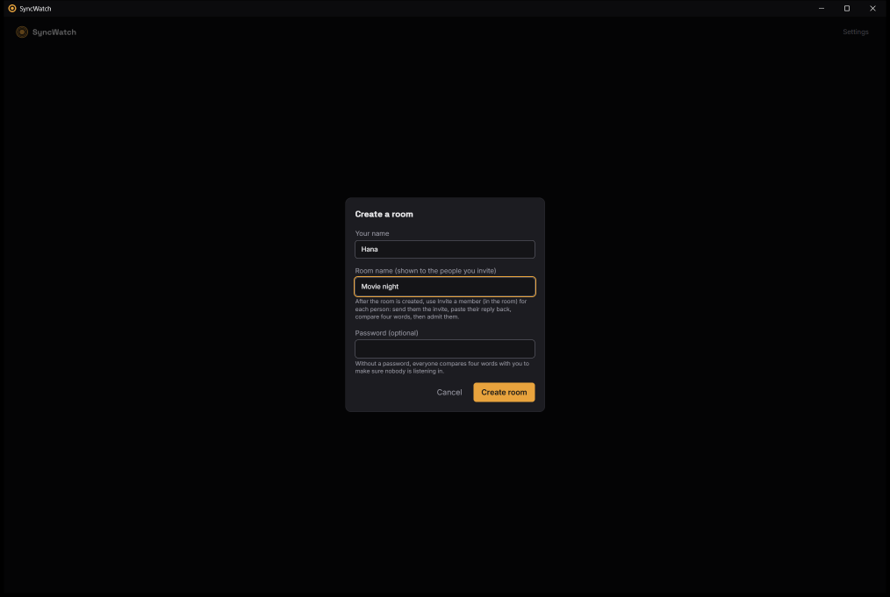
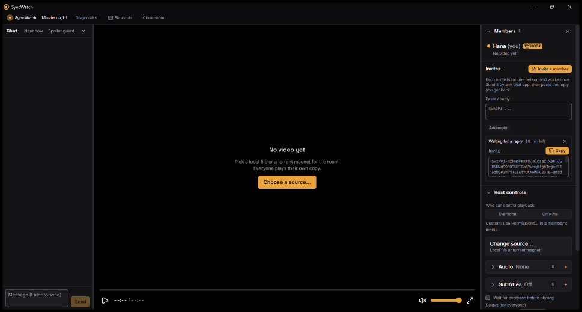
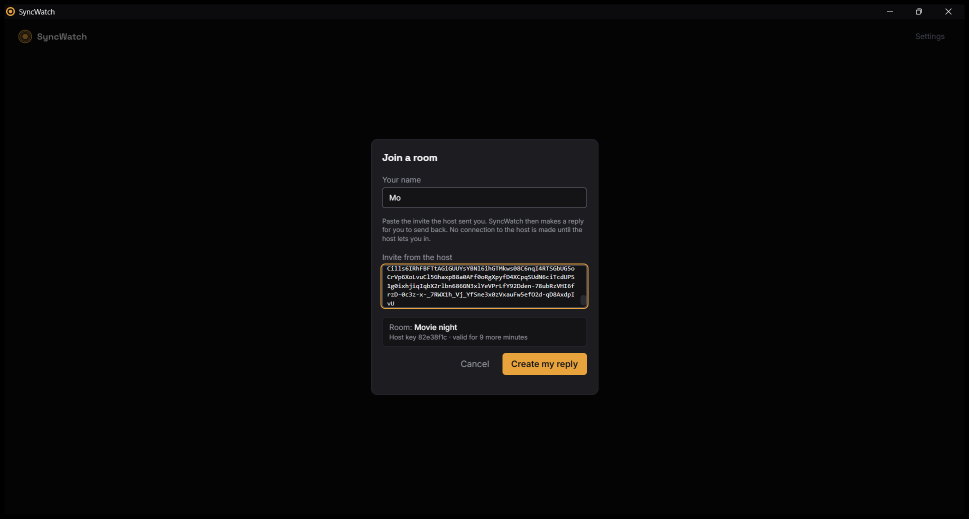
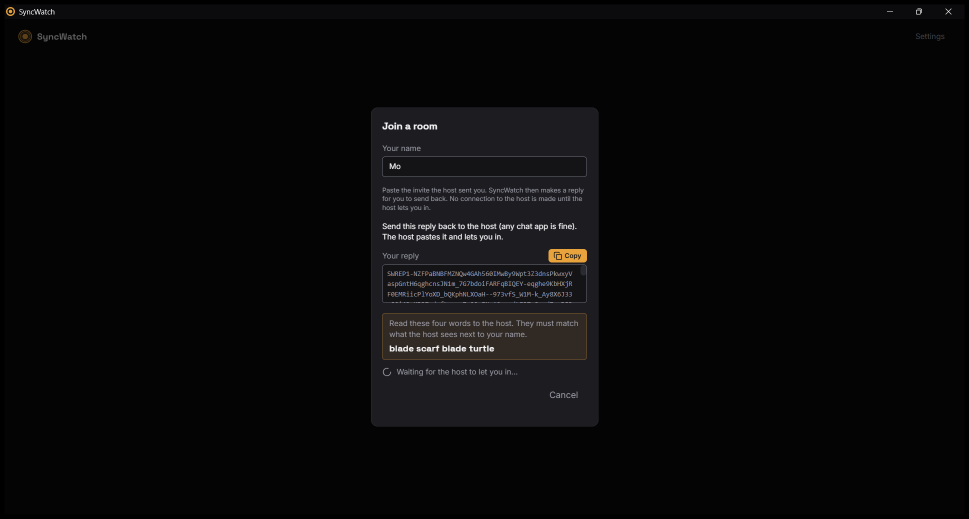
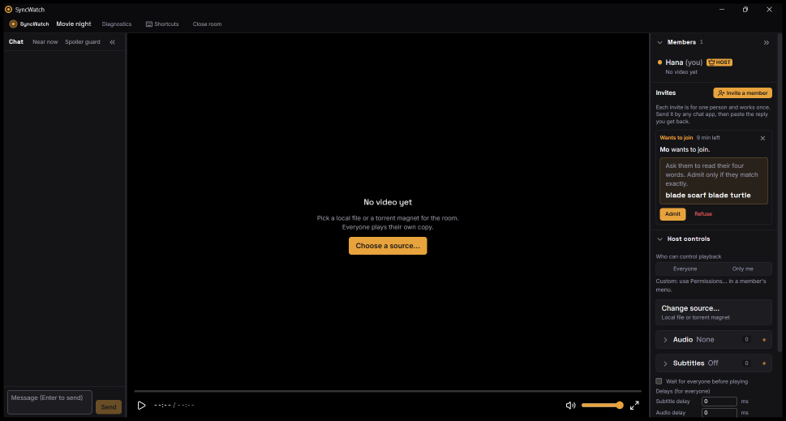
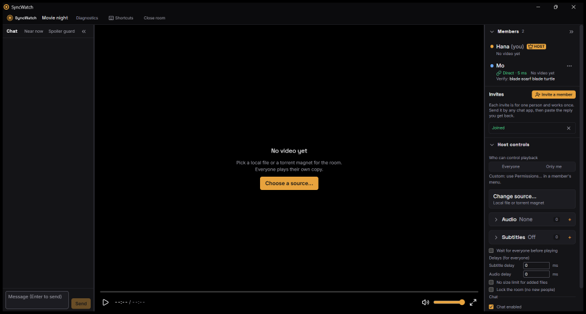
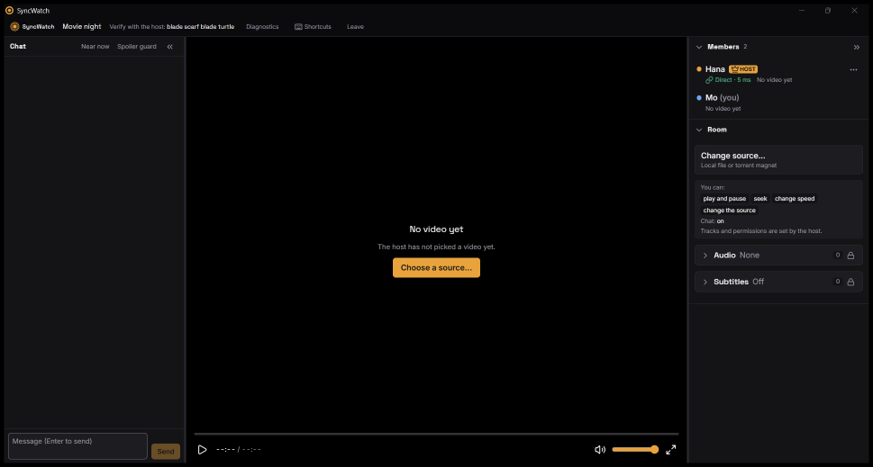
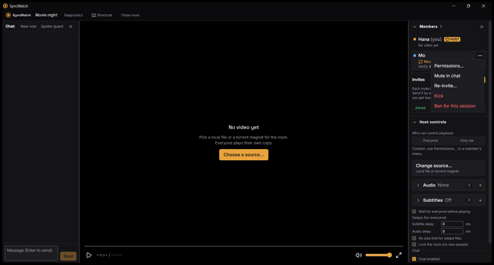

# SyncWatch user guide

Status: Milestone 9: install and updates, rooms with invites, torrents, settings, privacy
and known limits.

## Install, update and remove

### Install

1. Download `SyncWatch-<version>-x64.msi` from the latest release on
   https://github.com/ramdn99/syncwatch/releases.
2. Run it. It takes a few seconds (in Windows Sandbox it took about 5 minutes, because the
   sandbox checks the unsigned 337 MB package slowly; a normal PC does not). It installs for
   your Windows user only, into
   `%LOCALAPPDATA%\Programs\SyncWatch`, and asks for no administrator rights. Everything
   SyncWatch needs is inside, including the player and, if Windows lacks it, the WebView2
   runtime.
3. **Windows SmartScreen** may say "Windows protected your PC", because the installer is not
   code-signed. Click **More info**, check that the app is SyncWatch, then **Run anyway**.
   To check the download first, compare its SHA-256 with the release's `SHA256SUMS`:

```
Get-FileHash $HOME\Downloads\SyncWatch-0.1.0-x64.msi -Algorithm SHA256
```

### Updates

- When SyncWatch starts (never during a room), it asks GitHub whether a newer version exists.
  If one does, a card on the home screen says **Version X is available**, with what changed:
  - **Update now** downloads it (with progress and **Cancel**), then **Restart to update**
    closes SyncWatch, installs the new version (a short progress bar, no questions) and opens
    SyncWatch again. Your settings and relay setup stay.
  - **Later** asks again at the next start.
  - **Skip this version** stops asking about that version; a newer one is offered again.
- Every update is checked before it runs: it must be signed by the SyncWatch maintainer's key,
  match its published SHA-256, and be newer than what you have. Anything else is refused
  (no downgrades).
- Settings, About: **Check for updates when SyncWatch starts** (on by default) and **Check
  now**. With the switch off, SyncWatch never contacts GitHub.

### Remove

- **Windows Settings, Apps, Installed apps, SyncWatch, Uninstall** removes the program. Your
  settings, relay setup and torrent cache stay, so a later install picks them up.
- **To remove your data as well:** first use Settings, About, **Remove all my SyncWatch
  data...** in SyncWatch. It deletes the data folder (`%LOCALAPPDATA%\SyncWatch`: settings,
  the relay setup, logs, the torrent cache) and the two SyncWatch entries in Windows
  Credential Manager, then closes. Then uninstall. Downloads you saved to a folder of your own
  choice are not touched.
- From a command line, one step does both:

```
msiexec /x SyncWatch-0.1.0-x64.msi REMOVEUSERDATA=1
```

## Rooms: create, invite, join

SyncWatch has no server of its own. Each person connects with their own Metered relay account
(Settings, Connection). People join a room with a **copy-and-paste invite**:
1. The host sends an invite.
2. The member sends a reply back.
3. Both compare four words.
4. The host lets the member in.

Any chat app works for sending the texts: messages, email, a group chat.

### Host: create the room

1. Click **Create room**.
2. Enter your name and a room name (the room name is what the people you invite see).
3. Optionally add a password. Without one, the four words are your protection; with one,
   everyone also needs the password.



### Host: invite someone

1. In the room, under **Members**, click **Invite a member**.
2. After a few seconds the invite appears. Click **Copy** and send it to **one** person.
   - Each invite works **once**, for one person.
   - It stays valid for 10 minutes (Settings, Room defaults).



### Member: join with the invite

1. Click **Join room** and enter your name.
2. Paste the invite. SyncWatch shows the room name and how long the invite is still valid.
   If the room has a password, type it here.
3. Click **Create my reply**.



4. Click **Copy** and send the reply back to the host.
5. Read your **four words** to the host (a call or voice message is best), and wait. Nothing
   connects to the host until they let you in.



### Host: let them in

1. Paste the reply under **Paste a reply** and click **Add reply**.
2. The invite now shows the person's name and four words. Ask them to read their words.
   **Admit** only if all four match exactly; otherwise click **Refuse**.



The member joins within a few seconds. Both of you keep seeing the same words in the room
(next to the member's name, and at the top of the member's window).




### If something goes wrong

SyncWatch tells you what to fix when a pasted text cannot be used:
- **The text was cut off or changed while copying:** copy it again in full.
- **A reply was pasted where an invite belongs (or the other way round):** paste it on the
  other computer.
- **The invite expired or was already used:** ask the host for a new one.
- **"The other side runs a different version of SyncWatch (theirs: X, yours: Y)":** both of
  you need the same version (see Updates). Whoever pastes the other's text sees this, so tell
  the other person.
- **The connection did not match the invite:** something changed the texts on the way. Make
  a new invite and compare the words carefully.

**While the member waits.** After making the reply, the member sees the reply, the four words
and "Waiting for the host to let you in...", with **Cancel**. This step stays until the host
admits, refuses or the invite runs out, or until the member cancels. Take your time copying
the texts back and forth: the connection waits for the host.

**When the connection cannot be made**, both sides say why instead of a generic error:
- the host sees "Could not connect to <name>: <reason>" next to the invite, with
  **Re-issue**;
- the member sees "The host could not connect: <reason>".

The reason names the side whose text had no public or relay address (for example when its
relay setup is not working), or says that every network check failed even through the relay
(a firewall). Make a new invite after fixing what it names. If it keeps failing, turn on
**Always use relay** on both computers and test the connection in Settings, Connection.

**"Could not refresh the relay servers from Metered; the saved ones may have expired"** at the
top of a room means Metered did not answer in time when the room was made. SyncWatch then
tries the relay servers it saved last time. They often still work, but Metered can expire
them, so if nobody can connect, check Settings, Connection and make the room again.

### When someone drops out

- **Short hiccups** (a few seconds of Wi-Fi trouble) recover by themselves.
- **A connection that is really gone:**
  - The member sees "The connection to the host was lost".
  - The host sees the member as **Disconnected · seat kept**.
  - The host opens that member's menu (the dots next to the name), clicks **Re-invite...**,
    and sends the new invite.
  - The member joins with it as above and gets their seat back. Only that person can use a
    re-invite.
  - The seat is kept for 5 minutes (Settings, Room defaults).



### What is different from a room code

- Each person needs their own invite, and joining takes two copy-pastes.
- **Make host** is not available in rooms joined with invites.
- If the **host** leaves or loses their connection, the room ends for everyone. Someone creates
  a new room and invites the others again.

## Watching a torrent together

- **Host:** open Change source, then **Torrent**. There are two ways to add one:
  - **Magnet link:** paste it and choose **Get file list**. SyncWatch asks peers for the
    torrent's file list. This can take a moment, and it fails after 90 s if nobody shares the
    torrent; the message names the likely cause (nobody sharing it, a firewall, DHT off).
  - **Torrent file:** choose **Choose .torrent...** or drop a `.torrent` file on the dialog. Its
    name, infohash, total size and file list show at once, with no network.

  Then pick the video file. Only that file is downloaded, by everyone.
- **Members** see the torrent's name, the file the host chose and its size, and choose
  **Download and play** or **Decline**. Nothing is downloaded before they agree. Members never
  look for the file list themselves: they get it from the host. If the host is still getting it,
  they see "Waiting for the host to get the file list" and start as soon as it arrives.
- Everyone downloads their own copy, starting with the part the room is playing. A member who
  joins while the video plays starts right there, within seconds, not from the beginning of the
  file. Only the few hundred KB the player needs to open the file are taken from elsewhere.
  Playback stays in sync while downloading.
- **What counts is the part being played, not the total.** A member at 40% whose current part
  is downloaded is ready and never makes the room wait. Every member's download always fetches
  the part the room is playing first, also while it is still loading or waiting.
- **Seeking to a part that is not downloaded yet** pauses the room until that part has
  arrived. Then everyone continues together.
  - The member who is missing it sees "Buffering 60%: at 12:30, needs ~3 MB more to continue".
  - The host sees "Waiting for Bo: buffering at 12:30 (needs ~3 MB more)", with **Resume
    without them**. The members list shows "buffering at 12:30, 60% of the window".
  - The other members see "Waiting for Bo to catch up".

  Seeking back to downloaded parts is instant.
- The buffering message appears only when your own video really stops for missing data (after
  a short moment), and disappears as soon as it plays again.
- **No peers:** SyncWatch shows "waiting for peers" and retries by itself. What is already
  downloaded keeps playing.

### What you see while waiting

- "Waiting for the host to get the file list": a member is waiting for the host.
- "Looking for peers (DHT on, 3 trackers)": the host is fetching the file list.
- "4 peers found": downloading.
- "The torrent file was loaded, but no peers are sharing it yet": nobody shares the torrent.
  SyncWatch retries by itself.

SyncWatch cannot use **web seeds** (HTTP download addresses inside some torrents, common on the
Internet Archive). A torrent that relies only on web seeds and has no peers will not download.
The message then says so.

### Two people on the same router

People on the same home network usually share one public IP address. Many swarm clients
(qBittorrent, Transmission and others based on libtorrent) accept only **one connection per IP
address**. The first of you gets in; the second may be refused by those peers, or connected but
never sent any data.

What SyncWatch does about it:
- **On the same computer** (two windows, as in testing): members never need the swarm. They get
  the file list from the host, and download from the host's own torrent engine. If that link
  is lost, or a peer is connected but sends nothing, SyncWatch reconnects to the host within a
  few seconds.
- **On other computers in the same network:** each member downloads from the swarm on its own.
  SyncWatch does not tell members the host's local address, so a refused member depends on the
  other peers in the swarm. With a large swarm this rarely matters. With a small swarm, start
  the torrent on one computer first, or use a local file for everyone.

### When the download is complete

SyncWatch says: **"Downloading and sharing have stopped. No further traffic."**

At that moment it disconnects from every peer, tells the trackers it stopped, and shuts the
torrent engine down. That means no DHT, no listening port and no open connection. The video
keeps playing from the finished file, without a reload.

Other DHT nodes may keep your address listed for about 30 minutes; the DHT protocol has no way
to take a listing back. Nobody can connect to you during that time: every socket is closed and
the DHT is shut down.

When you join the room again, or restart SyncWatch, the finished file plays directly.
SyncWatch never joins the torrent's swarm again for it. There is no "keep seeding" option.

### Settings: Files and Network

**Files:**
- Torrent cache folder and size limit.
- Whether finished files are kept after leaving a room.
- **Largest torrent file list:** 5 MB by default (1 to 16 MB). Bigger .torrent files, or file
  lists offered by a host, are refused.
- **Buffering window:** how much of the video around the room position must be downloaded
  before you count as ready. The default is 1 s before the position (0 to 10 s) and 5 s after
  it (2 to 60 s). A larger window waits longer before playing but stalls less on a slow
  swarm.
- **Start-up range:** what the player is expected to read to open a file. The default is
  1024 KB (256 to 8192 KB). Measured: MKV and MP4 files needed at most 512 KB at the start.

Each number shows its default and has **Reset to default**. A value outside its range is not
saved; the reason is shown under the field.

**Network:**
- Incoming torrent port and bind address.
- DHT on or off.

**Your responsibility:** you are responsible for what you stream. Only use torrents you have
the right to download and share. While a torrent downloads, other people in its swarm can see
your IP address.

## Settings

Open **Settings** on the home screen. The sections are:

- **Connection:** the relay setup (Metered): status, test, replace, remove.
- **Playback:**
  - **Hardware decoding:** on by default, with a safe software fallback.
  - **Subtitle size:** 50–200%, for text subtitles only. Image subtitles (PGS, VobSub) keep
    their own size.
  - **Buffering:** how it works (fixed values).

  Hardware decoding and subtitle size apply the next time SyncWatch starts.
- **Room defaults:**
  - who controls playback in a new room (Everyone or Only me);
  - how long the room waits for members after a seek or a pause for buffering (5–120 s,
    default 15).
- **Chat:**
  - the limits: 500 characters, 5 messages in 5 seconds, a slow mode set by the host, and the
    history;
  - **Export this room's chat...**, which saves the current room's chat as a text file.
    Nothing from a room is kept otherwise.
- **Files:**
  - the size ceilings for added subtitle files (20 MB) and audio files (1 GB), and **No
    limit** as the default for new rooms;
  - the torrent cache, the largest torrent file list, and the buffering window.
- **Network:** **Always use relay**, the incoming torrent port, the bind address, and DHT.
- **About:** the version, the GPL notice, the third-party licenses, **Copy diagnostics**
  (a report with credentials, keys, tokens and IP addresses removed), the update switch and
  **Check now**, and **Remove all my SyncWatch data...** (see "Install, update and remove").

## Privacy

- **Chat:** messages are encrypted between each person and the host. The host passes them on
  to everyone and **can read all of them**. Chat is kept in memory only: it is never written to
  disk or to the logs. **Export this room's chat...** (Settings, Chat) is the only way to save
  it.
- **Your IP address:**
  - Without **Always use relay**, people you connect to directly (the host, or the members if
    you are the host) can see your address.
  - With it on (Settings, Network), they only see the relay's address, which uses more of your
    relay quota.
  - **Invites and replies contain your connection addresses** (the network addresses WebRTC
    found, or only the relay's with **Always use relay**). Send them only to the person you
    invite. They never contain your Metered key or relay credentials.
  - A torrent's swarm sees your address whatever the relay setting is (see "Watching a
    torrent together").
- **Latency:** the members list shows each member's round-trip time to the host (for example
  "Direct · 42 ms"). Everyone in the room can see it. It is not an address.
- **The four words:** compare them with the other person by voice or another channel you trust
  before the host clicks **Admit**. Someone who copied an invite from a group chat, or who
  changed the texts on the way, gets different words: refuse them. The password (if the room
  has one) and Kick and Ban protect the room as well.
- **No telemetry.** SyncWatch connects only to:
  - the relay (STUN/TURN) servers;
  - Metered's API, when you set it up;
  - GitHub, to check for and download updates (one small request when SyncWatch starts, sent
    as a plain download: no account, no identifier beyond what any download shows, your IP
    address and the SyncWatch version; Settings, About, it can be turned off);
  - the people in your room;
  - in torrent rooms, the torrent's swarm.
- **Diagnostics:** **Copy diagnostics** removes credentials, keys, tokens, IP addresses and
  folder paths before anything reaches your clipboard. Logs also contain no credentials, no
  chat and no full paths.

## Known limits

- **Image subtitles (PGS, VobSub, DVB) ignore the subtitle size and style settings.** They are
  pictures, so they are shown exactly as authored. The size setting (Settings, Playback) applies
  to text subtitles (SRT, ASS, SSA, WebVTT) only.
- **Subtitles in non-Latin scripts** use the bundled Noto Sans for Latin, Greek and Cyrillic.
  Arabic, Hebrew, Chinese, Japanese, Korean, Thai, Hindi and others use the fonts that come
  with Windows. A script with no Windows font shows boxes. Fonts embedded in an MKV are always
  used.
- **File dialogs follow the Windows theme.** The open and save dialogs belong to Windows, so
  they are light when Windows is set to light mode, even though SyncWatch itself is always dark.
- **After a torrent finishes, other DHT nodes may list your address for about 30 minutes.**
  The DHT protocol cannot take an announcement back. Nobody can connect to you in that time:
  SyncWatch has closed every connection and shut the DHT down (see "When the download is
  complete").
- **Two people on the same router** may not both get data from the same outside peer, because
  many torrent clients accept only one connection per IP address. On separate computers in one
  network, SyncWatch does not connect members to the host's download, so with a small swarm
  one of you may wait. See "Two people on the same router" above.
- **No web seeds.** Torrents that are shared only through web seeds (HTTP download links inside
  the torrent, common for Internet Archive items) do not download: SyncWatch's torrent engine
  does not support them. SyncWatch says so when such a torrent has no peers.
- **A portable copy on another PC or Windows user** cannot read the saved relay setup (it is
  encrypted for the user who saved it). SyncWatch says so and asks you to set the connection up
  again.
- **Everyone needs the same SyncWatch version.** People on different versions cannot be in
  the same room. SyncWatch says "The host runs a different version of SyncWatch" when this
  happens.
